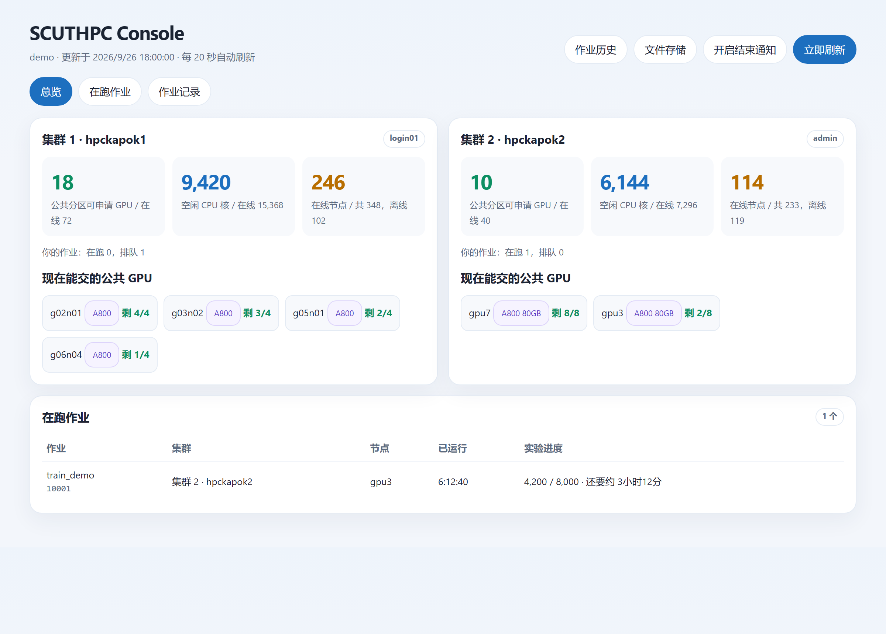
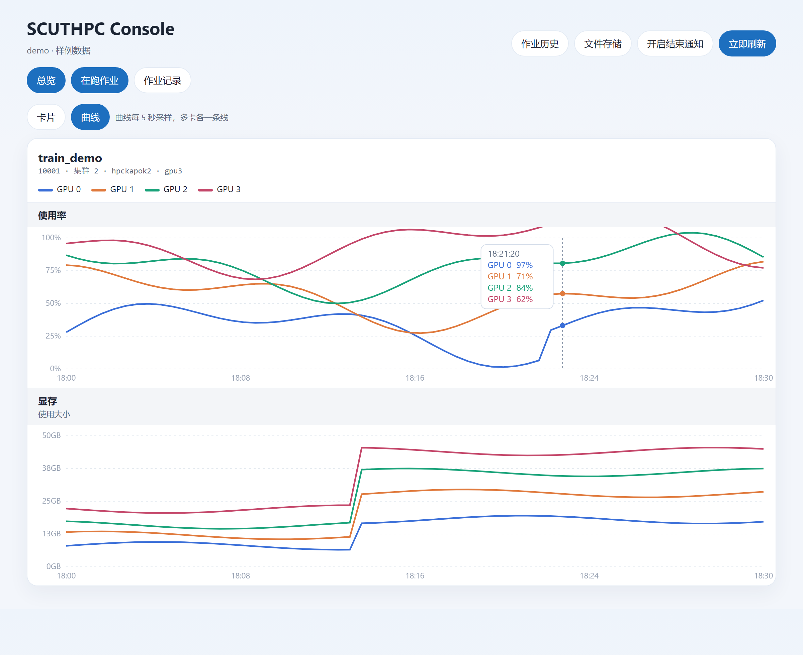
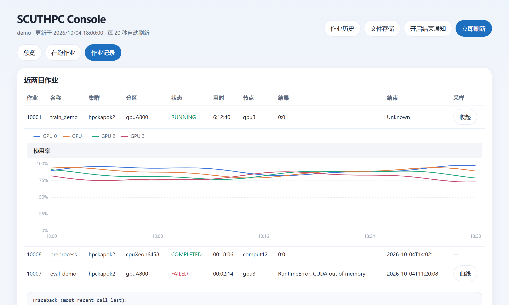
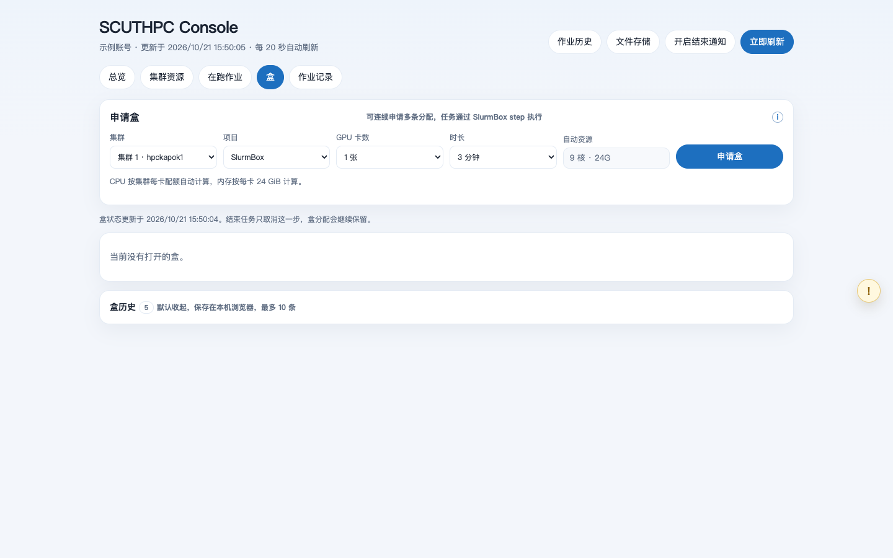

# SCUTHPC Console

SCUTHPC Console 是一个面向华南理工大学高性能计算平台用户、由第三方开发的本地控制台综合应用。它把集群监控、SCUTHPC 使用指南和持久资源分配工具放在同一个开源项目中，让用户可以在浏览器里查看资源与作业状态，并在需要时申请一条可复用的 GPU 资源分配。

项目默认监听 `127.0.0.1`。如果本机检测到 Tailscale，服务也会监听 Tailscale IPv4 地址，供同一 Tailnet 中的设备访问。集群凭据保留在本机 SSH 配置中，不写入项目文件。

## 主要功能

- **资源总览**：查看各集群、分区、节点和 GPU 的可用情况，并估算单节点可放置的 GPU 数量。
- **作业监控**：查看正在运行和排队的作业，采集 GPU 利用率、显存、温度和功耗，并支持曲线查看。
- **作业记录**：浏览近两日作业状态和日志摘要，保留本机采集到的短期 GPU 历史。
- **盒（SlurmBox）**：申请一条持久 Slurm 资源分配，先申请资源，再通过独立命令提交多个运行步骤。某个子任务结束时，整条资源分配不会自动释放。
- **集群使用 skill**：项目内置 SCUTHPC skill 和 SlurmBox skill，方便开发 agent 或用户查阅集群规则、资源选择和运行流程。

## 界面预览

以下截图使用样例数据：









## 项目结构

```text
SCUTHPC-Console/
├── app.py、serve.py          # 兼容启动入口
├── scuthpc_console/          # FastAPI、采集和盒服务实现
├── static/                   # 浏览器控制台
├── skills/
│   ├── scut-hpc/             # SCUTHPC 集群使用 skill
│   └── slurmbox/             # SlurmBox CLI、协议和文档
├── sandbox/                  # 默认盒项目目录（仅保留占位文件）
├── tests/                    # 本地测试
└── docs/                     # 截图和本地运行说明
```

## 快速开始

### 1. 准备 SSH

请先确认本机可以通过 SSH 登录两个集群，并准备好项目默认使用的主机别名：

- `scut-hpc1`：集群 1（hpckapok1）
- `scut-hpc`：集群 2（hpckapok2）

集群连接、分区和作业规则见 [SCUTHPC skill](skills/scut-hpc/SKILL.md)。

### 2. 安装依赖

```bash
python3 -m venv .venv
source .venv/bin/activate
python -m pip install -r requirements.txt
python -m pip install -e skills/slurmbox
```

Windows 用户可以使用 `.venv\Scripts\activate` 激活虚拟环境。

### 3. 创建配置

```bash
cp config.example.json config.json
```

根据本机 SSH 别名和项目目录修改 `config.json`。这个文件已被 Git 忽略，不应提交集群账号、密钥或其他私密信息。

### 4. 启动控制台

```bash
source .venv/bin/activate
python serve.py
```

然后打开 <http://127.0.0.1:8765>。本地启动、LaunchAgent 和故障排查说明见 [docs/LOCAL_SETUP.md](docs/LOCAL_SETUP.md)。

## 使用盒（SlurmBox）

盒页面支持选择集群、GPU 卡数和申请时长，并根据集群配额自动计算 CPU 和内存。默认申请时长为 3 分钟，进入队列后可以尝试更新时限；也可以连续申请多条分配。

安装 CLI 后，可以在配置的项目目录中使用：

```bash
slurmbox doctor --dry-run
slurmbox start
slurmbox exec -- python train.py
```

保活分配只负责维持资源，不执行用户代码。用户命令通过独立的 Slurm step 运行。完整的状态协议和操作说明见 [SlurmBox skill](skills/slurmbox/SKILL.md)、[用户指南](skills/slurmbox/USER_GUIDE_ZH.md) 和 [架构说明](skills/slurmbox/ARCHITECTURE.md)。

## 开发与验证

项目使用标准库优先的 Python 实现。修改后可运行：

```bash
PYTHONPATH=skills/slurmbox/src python -m slurmbox --help
python -m py_compile app.py serve.py scuthpc_console/*.py skills/slurmbox/src/slurmbox/*.py
git diff --check
```

本地开发不会自动提交或取消集群作业。需要进行真实集群操作时，请先阅读 [AGENTS.md](AGENTS.md)、[SCUTHPC skill](skills/scut-hpc/SKILL.md) 和 [SlurmBox skill](skills/slurmbox/SKILL.md)。

## 隐私与数据范围

控制台只在本地保存配置、采集缓存和盒状态；它不会把 SSH 密钥、token 或验证码写入仓库。作业和 GPU 信息来自用户账号能够读取的 Slurm 接口。服务默认只绑定本机地址，启用 Tailscale 时会额外绑定 Tailscale IPv4 地址。

## 相关链接

- [华南理工科学计算平台](https://hpckapok.scut.edu.cn)
- [SCUT HPC 用户手册](https://hpc.scut.edu.cn/docs/guide.html)
- [SCUTHPC skill](skills/scut-hpc/SKILL.md)
- [SlurmBox skill](skills/slurmbox/SKILL.md)
